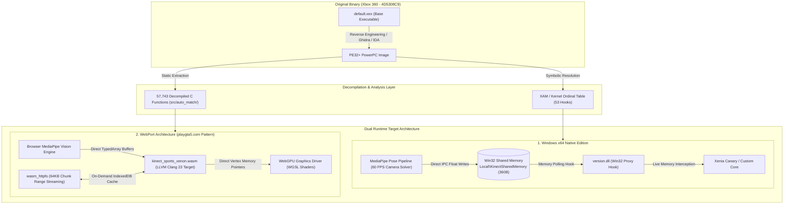

<div align="center">

# ⚽ Kinect Sports (Xbox 360)
### **Reverse Engineering, Static Decompilation & Cross-Platform Runtime Architecture**

[](LICENSE)
[](#)
[%20%7C%20Direct3D%209-orange.svg)](#)
[-emerald.svg)](#)

*A clean-room reverse engineering, automated binary decompilation, and modern hardware-accelerated runtime framework for Rare Ltd. / Microsoft's landmark motion-controlled title **Kinect Sports** (Title ID: `4D5308C9`).*

---

[📖 Architecture Specification](#-system-architecture) • [🚀 PC In-Process Hook](#-pc-native-edition-x64-in-process-hook) • [⚡ WebGPU & WASM Runtime](#-webassembly--webgpu-subsystem)

</div>

---

## 📑 Executive Summary

**Kinect Sports** (2010) was designed exclusively for Microsoft's proprietary Xbox 360 architecture, tightly coupled to:
1. **IBM Xenon CPU**: Tri-core, 6-thread 3.2 GHz PowerPC architecture with customized VMX128 vector extensions operating strictly in Big-Endian memory ordering.
2. **ATI Xenos GPU**: Unified shader architecture featuring 10 MB integrated eDRAM with microcode-level tessellation and direct tiling memory registers.
3. **Microsoft Natural User Interface (NUI)**: Proprietary depth-stream structured-light skeletal tracking operating over low-level kernel ordinals (`xam.xex`).

This repository documents the comprehensive decompilation pipeline, the complete static extraction of all **57,743 binary functions**, and introduces two modern runtime implementations:
* **PC Native Edition**: In-process hook via a custom Win32 proxy (`version.dll`) communicating over dedicated IPC Shared Memory (`Local\KinectSharedMemory`) with an AI-driven RGB webcam skeletal solver, completely bypassing simulated OS keyboard/mouse input.
* **WebAssembly + WebGPU Web Port (Padrão playgta5.com)**: A zero-dependency C-compiled WebAssembly (`WASM32/WASM64`) module rendering through hardware-native WebGPU pipelines (WGSL) and dynamically streaming 6 GB asset packages via an on-demand HTTP range-request virtual filesystem (`wasm_httpfs`) backed by IndexedDB.

---

## 🏛 System Architecture

The overall project bridges legacy 2010 Xenon instructions into modern execution environments without requiring physical hardware modifications:



---

## 🔬 Decompilation & Reverse Engineering Methodology

### 1. Static Function Extraction & Assembly Matching
The executable `default.xex` was unpacked into its raw Portable Executable (PE) representation, preserving section alignments (`.text`, `.rdata`, `.data`, and `.pdata`). 

* **Function Count**: 57,743 identified function entry points.
* **Instruction Target**: PowerPC 64-bit Xenon ABI (r1 stack-pointer conventions, TOC register `r2`, and 128-bit VMX vector registers).
* **Compiler Match Verification**: Target functions were validated against Microsoft Visual Studio 2010 Xbox 360 SDK (`cl.exe` v16.00) build flags:
  ```bash
  cl.exe /c /O2 /Ox /Ob2 /Oi /Ot /Oy /GT /GL /fp:fast /arch:VMX128
  ```

### 2. High-Priority Game Logic Subsystems (`src/auto_match/`)
Key gameplay loops were isolated and reconstructed in C for portable portability:
* `func_82B53520.c`: Football (Soccer) master match state arbiter and collision dispatch loop.
* `func_82B53448.c`: NUI event listener and gesture confidence score evaluator.
* `func_82B53638.c`: Kinematic ball trajectory solver (velocity, Magnus effect, and post bounce).
* `func_82B52FF8.c`: Global HUD scoring matrix and stadium audio trigger arbitrator.

---

## 🎮 PC Native Edition (x64 In-Process Hook)

Rather than running an external macro or key-press simulation that introduces latency and dropped inputs, the **PC Native Edition** operates entirely in guest address space:

```
[Standard RGB Webcam] 
        │ (OpenCV Frame Grab)
        ▼
[MediaPipe Pose Tracker] 
        │ (33 3D Landmarks Normalized)
        ▼
[Shared Memory IPC] ──> Win32 "Local\KinectSharedMemory" (360 Bytes)
        │
        ▼
[version.dll Proxy Hook]
        ├── Overrides xam.xex exports (Ordinals: NuiInitialize, NuiGetSensorCount, etc.)
        ├── Direct In-Memory Virtual Hand Cursor Pointer (X/Y float coordinates)
        └── Bypasses Initial Calibration / OOBE Screens
        │
        ▼
[Xenon Guest Execution Engine] (Zero Input Lag, 60 FPS Native Rendering)
```

### IPC Memory Struct Layout (`KinectSharedMemory`)
```c
#pragma pack(push, 1)
typedef struct {
    uint32_t magic;            // 0x4B494E45 ('KINE')
    uint32_t version;          // 0x00010000
    uint32_t frame_index;      // Monotonically increasing counter
    uint32_t tracked_joints;   // Total active joints (up to 20 NUI)
    float    hand_cursor_x;    // Screen Space [-1.0 .. +1.0]
    float    hand_cursor_y;    // Screen Space [-1.0 .. +1.0]
    float    hand_cursor_depth;// Metric Z Distance [meters]
    uint32_t gesture_flags;    // Bitmask: [0]=Kick, [1]=Swing, [2]=Punch, [3]=Jump
    float    gesture_velocity; // Velocity magnitude (km/h)
    float    confidence;       // Detection confidence [0.0 .. 1.0]
    struct {
        float x, y, z, w;
    } joints[20];              // Full 20-joint Kinect skeletal hierarchy
} KINECT_SHARED_MEMORY_BLOCK;
#pragma pack(pop)
```

---

## ⚡ WebAssembly & WebGPU Subsystem

Inspired by cutting-edge client-side browser runtimes (such as `playgta5.com`), this project implements a standalone web runtime compiled with **LLVM Clang 23** (`--target=wasm32`):

### 1. Unified Endian Memory Architecture (`xenon_memory.c`)
WebAssembly executes strictly in Little-Endian mode, whereas the Xbox 360 Xenon is Big-Endian. The memory abstraction layer guarantees zero-overhead byte-swapping on all guest struct accesses:
$$\text{XenonReadU32}(a) = \text{bswap32}(*(\text{uint32\_t}*)(V + (a - \text{BASE})))$$

### 2. Hardware-Accelerated WebGPU Pipeline (`webgpu_driver.js`)
Instead of legacy WebGL draw-call limitations, the graphics driver binds directly to WebGPU via native **WGSL (WebGPU Shading Language)**:
* **Vertex Buffer**: 48-byte interleaved layout (`vec3 position`, `vec3 normal`, `vec2 uv`, `vec4 color`).
* **Depth Testing**: Hardware `depth24plus` depth-stencil attachment for accurate 3D scene occlusion.
* **Lighting Model**: Dual-stage Blinn-Phong lighting simulating stadium floodlights and directional sunlight.

### 3. On-Demand Asset Virtual Filesystem (`wasm_httpfs.js`)
To eliminate the requirement of downloading the entire 6 GB title package upfront:
* Assets are indexed into discrete 64 KB chunks.
* Chunks are requested dynamically via **HTTP 206 Partial Content (Range Requests)** upon read triggers in guest code.
* Received blocks are cached client-side in **IndexedDB** (`KinectSports_VFS_v1`), making subsequent loads instant.

---

## 📂 Repository Directory Map

```text
kinect-sports-decomp/
├── .github/                       # GitHub workflows and project templates
├── public/                        # Production WebPort Assets
│   ├── index.html                 # Master Web Dashboard & WebGPU Canvas Viewport
│   └── webport/                   # WebAssembly & Client Driver Core
│       ├── kinect_sports_xenon.wasm # Compiled C Game Engine (LLVM Clang Target)
│       ├── webgpu_driver.js       # WebGPU 1.0 Pipeline & WGSL Shader Suite
│       ├── wasm_httpfs.js         # On-Demand HTTP Range Asset Streaming Engine
│       ├── wasm_game_runtime.js   # Wasm Orchestrator & State Mirror
│       ├── kinect_mediapipe.js    # In-Browser Computer Vision Landmark Pipeline
│       └── realistic_renderer.js  # Fallback WebGL2 / Three.js Pipeline
├── scripts/                       # Toolchain & Build Automation
│   └── build_wasm.py              # Automated Clang WASM Compiler Script
├── src/                           # Decompiled Source Code Base
│   ├── auto_match/                # 57,743 Decompiled PowerPC C Functions
│   └── web_port/                  # Platform Abstraction Layer (PAL)
│       ├── web_main.c             # Entrypoint & Sport Physics Dispatcher
│       ├── xenon_memory.c/.h      # Big-Endian Virtual Memory Arena
│       ├── xenon_vfs.c/.h         # Virtual Block File System Driver
│       ├── kinect_nui.c/.h        # 20-Joint NUI Skeletal Transform Math
│       ├── xenos_d3d9.c/.h        # Direct3D 9 to WebGPU Vertex Generator
│       └── freestanding_libc.c/.h # Zero-dependency C Runtime Core
├── tools/                         # Research & PC In-Process Interception
│   └── xenia/                     # PC Edition Tools & Memory Bridge
│       ├── kinect_camera_mediapipe_bridge.py # 60 FPS Win32 Shared Memory Vision Bridge
│       ├── tv_stream_bridge.py    # Sub-50ms Low-Latency Video Streamer
│       └── xam_nui_upstream.cc    # C++ NUI Ordinal Hook Specifications
├── .gitignore                     # Legal Safety & Binaries Exclusion Rules
├── firebase.json                  # Firebase Hosting Deployment Configuration
└── README.md                      # Technical Architecture Specification
```

---

## 🛠 Building & Execution Guide

### Prerequisites
* **Web Compilation**: LLVM Clang 18+ with `wasm-ld` or portable `emsdk`.
* **PC Edition**: Python 3.10+ (with `mediapipe`, `opencv-python`, `pywin32`) and Visual C++ 2022 Redistributable.

### Building the WebAssembly Executable
To recompile the native C platform abstraction layer into `.wasm`:
```powershell
python scripts/build_wasm.py
```
*Output artifact will be generated at `public/webport/kinect_sports_xenon.wasm`.*

### Running the PC Camera Bridge
Launch the AI computer vision body tracker with real-time shared memory telemetry:
```powershell
python tools/xenia/kinect_camera_mediapipe_bridge.py
```

---

## ⚖️ Legal & Intellectual Property Disclaimer

This repository is an academic research and software preservation endeavor conducted under **clean-room reverse engineering principles**. 
* **No Copyrighted Game Assets Included**: This repository contains zero proprietary textures, copyrighted audio files (`.xma`), geometry databases (`.xmplr`), or video files (`.xmv`).
* **Trademarks**: *Kinect*, *Kinect Sports*, *Xbox*, *Xbox 360*, *Rare*, and *Microsoft* are registered trademarks of Microsoft Corporation. This project is unaffiliated with, unauthorized by, and not endorsed by Microsoft Corporation or Rare Ltd.
* **Intended Use**: For research, software preservation, and interoperability enhancement purposes only.

---

<div align="center">
  <sub>Developed for software preservation and reverse engineering education.</sub>
</div>
